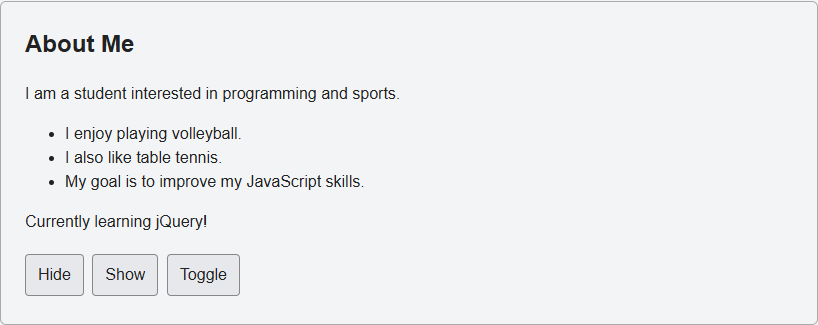
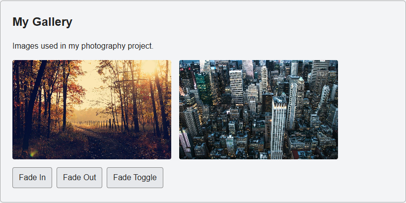
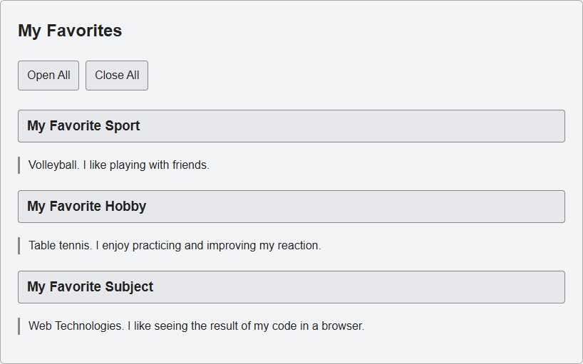
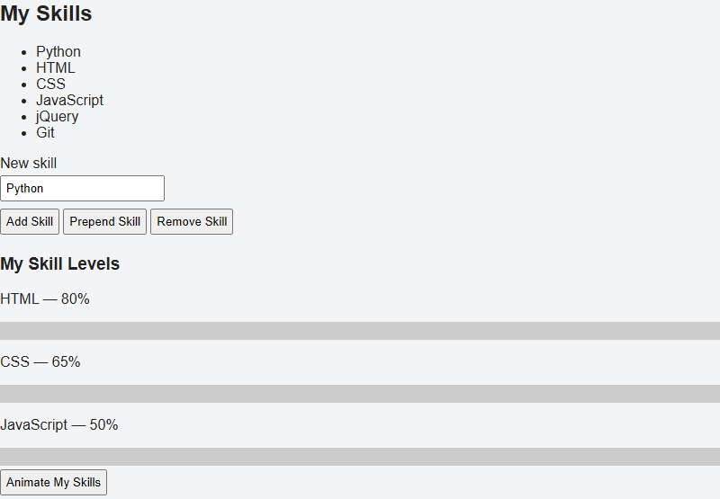
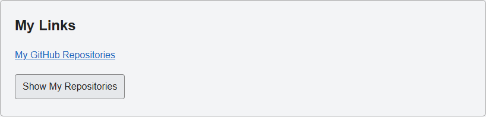
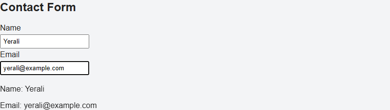
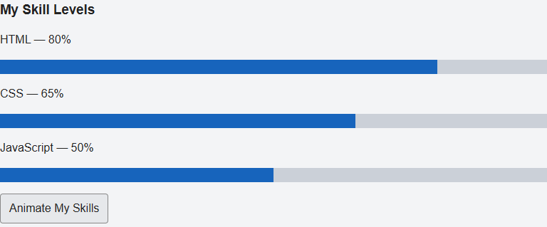

# Assignment 6: jQuery

**Name:** Yerali Karkinbayev  
**Group:** IT-2501

Open "index.html" in a browser. Internet is needed to load jQuery from the CDN.

## Part 1. Getting Started with jQuery

### Task 0. Setup

jQuery is loaded from a CDN. The ready function prints "jQuery is ready!" in the browser console.

### Task 1. Selectors and CSS

Tag, ID and class selectors change the heading and introduction. Two buttons switch the theme.

## Part 2. jQuery Effects

### Task 2. Visibility

Hide, Show and Toggle control the status message in About Me.

### Task 3. Fade

Fade In, Fade Out and Fade Toggle control two gallery images.

### Task 4. Slide

Clicking a heading toggles its panel. Open All and Close All expand and collapse all three panels.

## Part 3. DOM Manipulation

### Task 5. Add and Remove Elements

Skills can be added to the end or beginning of the list. Remove Skill deletes the last item. Empty input is ignored.

### Task 6. Modifying Attributes

The button changes the GitHub link to the repositories tab using ".attr()".

### Task 7. Form Interaction

Name and email appear below the form while typing, using ".val()" and ".text()".

## Part 4. Animations

### Task 8. Skill Bars

The bars start at zero. The button animates them to 80%, 65% and 50%. Clicking again returns them to zero.

## Work Process

The page structure was made in HTML and styled with CSS. jQuery handles the buttons, inputs and animations. Each task was checked in the browser.
